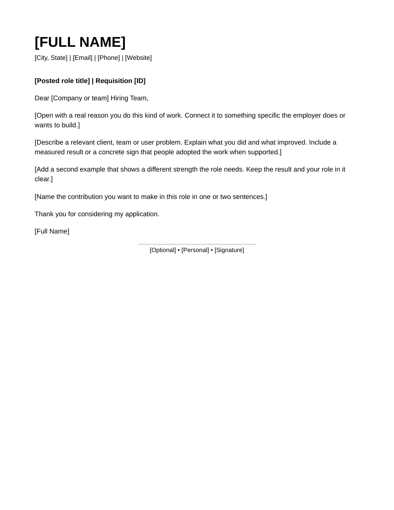

# Default cover-letter template

[Templates](../README.md)

A one-page letter that matches the default résumé: the same name and contact header, an optional role and requisition subject line, a left-aligned sign-off and an optional personal signature below a short centered rule.

- [Style guide](style-guide.md): how to write the letter, the plain-language pass, layout and checks.
- [Editable HTML](cover-letter.html): the template with bracketed placeholders.
- [Rendered PDF](cover-letter.pdf): the visual reference.
- Contact values come from [career/contact.json](../../career/contact.json).

The placeholder text is guidance, not career evidence. Save application-specific letters outside this folder.
