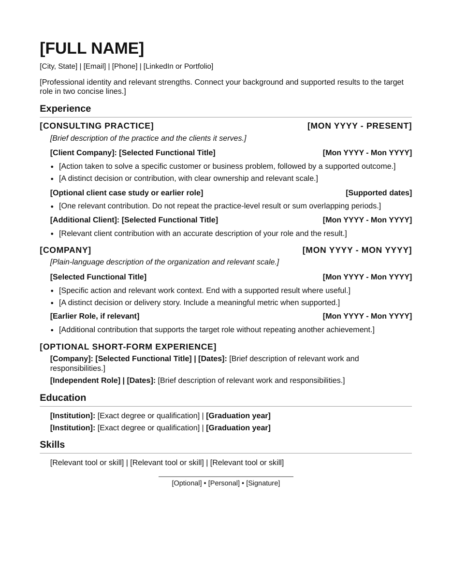

# Default résumé template

[Templates](../README.md)

A content-independent, single-column layout built to be read by both people and screening software (applicant tracking systems). Employer headings in caps, role headings indented, gray section rules, dates at the right margin.

- [Style guide](style-guide.md): structure, hierarchy, dates, optional blocks, pagination, contact details and the personal signature.
- [Layout reference](layout-reference.md): exact typography, spacing and the manual verification checklist.
- [Editable HTML](resume.html): flowing layout with bracketed placeholders.
- Build: `python3 tools/build_resume.py resume.html` renders the PDF, measures the layout and runs the screening check in one step ([Stage 2](../../agents/stage-2-resume.md#build-and-check-before-delivery)). Only if the build cannot run: open the HTML in a browser and print US Letter at 100% with headers and footers off.
- [Rendered PDF](resume.pdf): the visual reference.
- Contact values come from [career/contact.json](../../career/contact.json).

The placeholder text is guidance, not career evidence. Save application-specific résumés outside this folder. To use your own design instead, see [custom templates](../custom/README.md).
